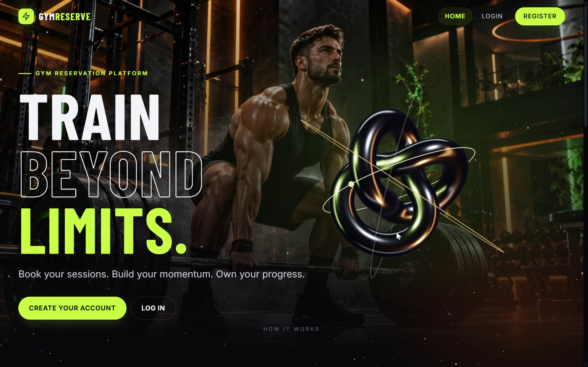
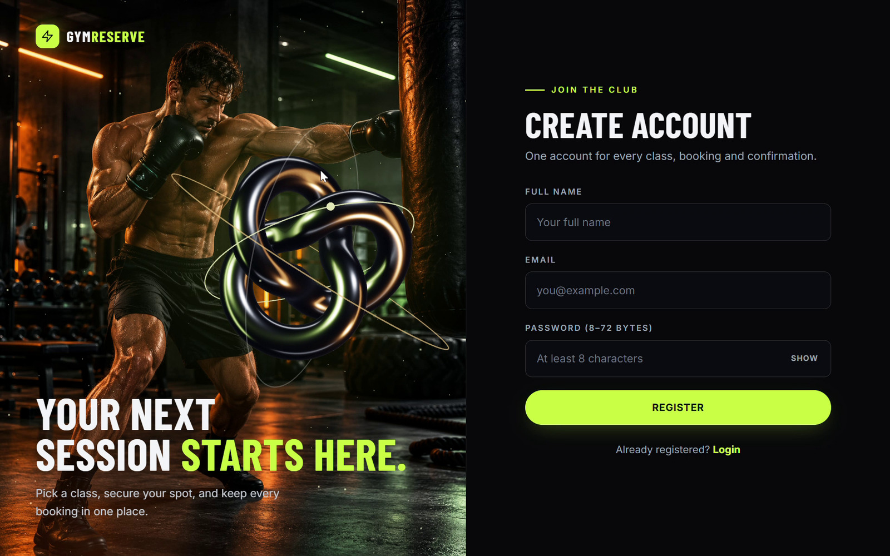
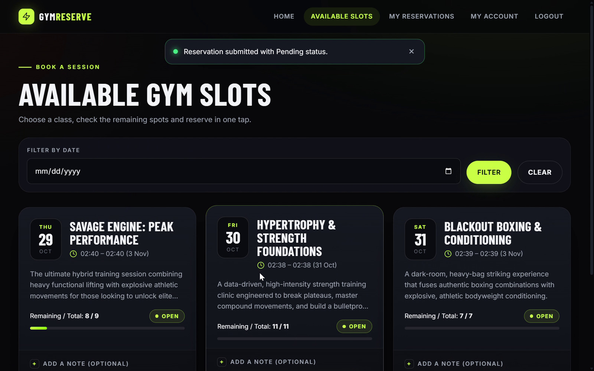
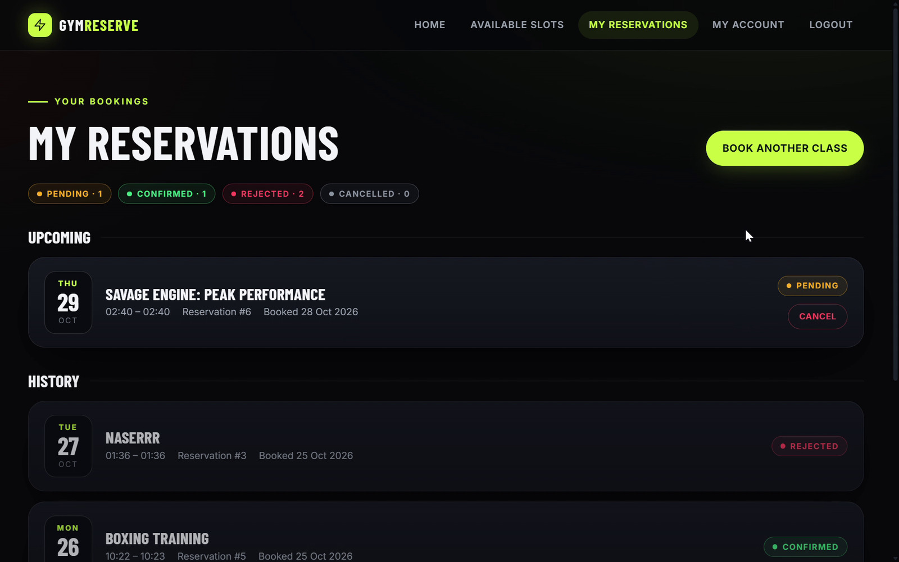
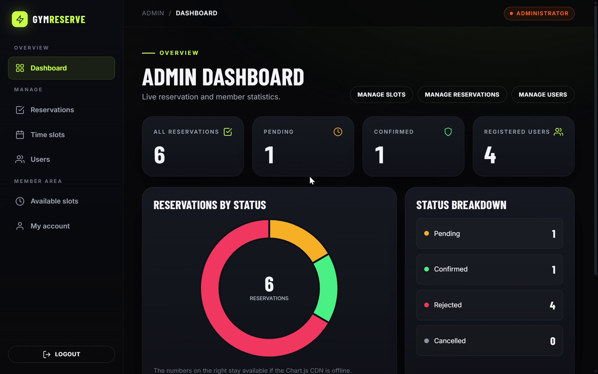
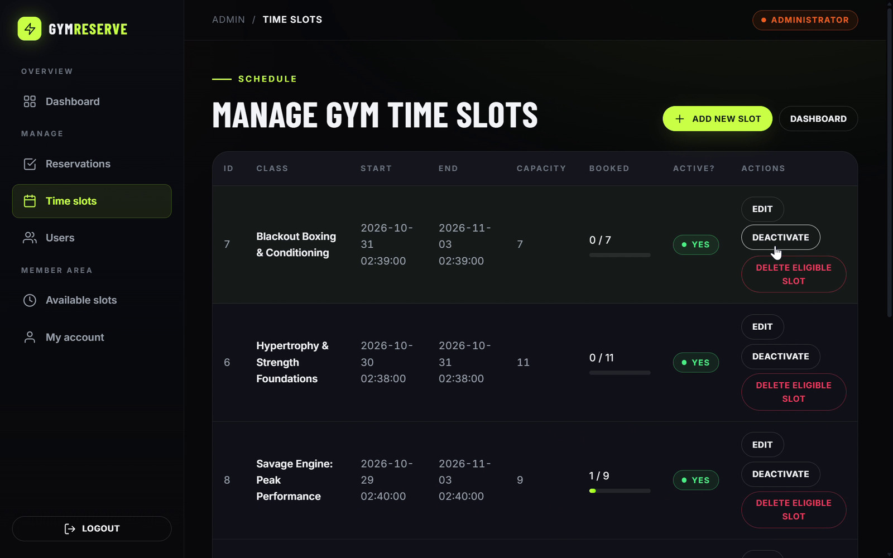
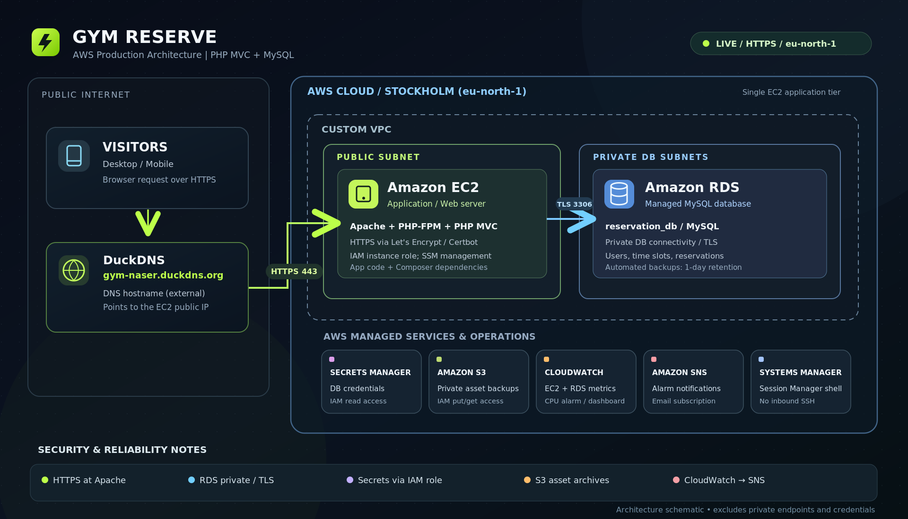

<div align="center">

# ⚡ GYM RESERVE

### Train Beyond Limits. Book Beyond Hassle.

**A full-stack sports & fitness class booking platform — built with PHP OOP & MySQL, deployed on AWS.**

[](https://www.php.net/)
[](https://aws.amazon.com/rds/)
[](https://aws.amazon.com/)
[](https://letsencrypt.org/)

**[🌐 Live Website](https://gym-naser.duckdns.org)** &nbsp;·&nbsp; **[📸 Screenshots](#screenshots)** &nbsp;·&nbsp; **[☁️ AWS Architecture](#aws-architecture)**



</div>

---

## 📌 Overview

**Gym Reserve** is a class reservation and administration system for gyms and fitness clubs. It brings the complete booking journey into one place: members can discover available training sessions, request a place, monitor reservation statuses, and manage their bookings. Administrators can manage training slots, members, and incoming reservation requests.

This project also documents the journey **from local PHP development to a running cloud deployment**, using a dedicated Amazon EC2 web server and a private MySQL database on Amazon RDS.

> **Project focus:** PHP Object-Oriented Programming, MVC structure, secure database access, full-stack workflows, and hands-on AWS operations.

## ✨ Key Features

| 🏋️ Member Experience | 🛡️ Administrator Experience |
| --- | --- |
| Register, sign in, and sign out | View a dashboard with booking statistics |
| Browse upcoming fitness classes and time slots | Create, edit, activate, and deactivate slots |
| Filter available slots by date | Manage booking requests and their statuses |
| See class capacity and remaining places | Confirm, reject, or cancel eligible reservations |
| Request a reservation with an optional note | View and manage member accounts |
| Follow `Pending`, `Confirmed`, `Rejected`, and `Cancelled` statuses | Enforce role-based access to administrative pages |
| View reservation history and cancel eligible future bookings | Preserve reservation history when applicable |

### Booking Workflow

```text
Browse available classes
        ↓
Choose a future time slot
        ↓
Submit booking request
        ↓
      Pending
        ↓
Admin reviews request
   ↙          ↘
Confirmed    Rejected
```

The system uses capacity checks and database-level constraints to help prevent overbooking and duplicate bookings. Submitting a request **does not automatically mean it is confirmed**.

---

<a id="screenshots"></a>

## 📸 Screenshots

*Captured from the running Gym Reserve interface. Screens containing private email addresses were excluded.*

| Home / Landing Page | Create an Account |
| :---: | :---: |
|  |  |
| **Available Fitness Classes** | **My Reservations** |
|  |  |
| **Admin Dashboard** | **Manage Time Slots** |
|  |  |

---

## 🧰 Technology Stack

| Layer | Technologies |
| --- | --- |
| **Back end** | PHP 8, Object-Oriented Programming (OOP), MVC-style separation |
| **Database** | MySQL, PHP Data Objects (PDO), prepared statements |
| **Front end** | HTML5, CSS3, JavaScript, responsive UI |
| **Visual experience** | Three.js, GSAP, Chart.js |
| **Web server** | Apache HTTP Server, PHP-FPM |
| **Dependency management** | Composer, AWS SDK for PHP (production integration) |
| **Cloud hosting** | Amazon EC2, Amazon RDS, Amazon VPC |
| **Operations & security** | IAM, Security Groups, Secrets Manager, CloudWatch, SNS, S3, Systems Manager |
| **Domain & HTTPS** | DuckDNS, Let's Encrypt / Certbot |

<a id="aws-architecture"></a>

## ☁️ AWS Deployment Architecture

<div align="center">



**[View full-resolution diagram](GymReserve_GitHub_Complete_Kit/docs/architecture/aws-architecture.png)** · **[SVG version](GymReserve_GitHub_Complete_Kit/docs/architecture/aws-architecture.svg)**

</div>

### How the production environment works

1. **Visitors** reach `gym-naser.duckdns.org` over HTTPS. The DuckDNS hostname resolves to the EC2 public IP; this deployment **does not use Route 53**.
2. **Amazon EC2**, inside a public subnet of the custom VPC, serves the PHP application through Apache and PHP-FPM. Let's Encrypt / Certbot provides the site's HTTPS certificate.
3. **Amazon RDS for MySQL** is accessed from the application tier through a private database connection using TLS. The database is not intended to be publicly reachable.
4. **AWS Secrets Manager** stores the production database credentials. The EC2 instance role authorizes the application to read the database secret without committing credentials to source control.
5. **Amazon S3** stores a private archive of application assets for backup. This is **not** a claim that all database content is backed up to S3.
6. **Amazon CloudWatch** monitors EC2 and RDS metrics. An EC2 CPU alarm is connected to an **Amazon SNS** email notification topic.
7. **AWS Systems Manager Session Manager** is used for instance administration without enabling inbound SSH. RDS automated snapshots provide separate database recovery coverage, with **one-day retention in this deployment**.

> **Architecture scope:** This diagram depicts the deployed components and their intended data flows, not a fully automated Infrastructure-as-Code template or a multi-instance high-availability deployment.

---

## 🔐 Security & Data Integrity

- Password hashes are stored using PHP password-hashing functionality; login verifies hashes rather than comparing plaintext passwords.
- Sensitive SQL inputs are handled through **PDO prepared statements**.
- HTML output is escaped in views to reduce cross-site scripting risks.
- State-changing forms use **CSRF tokens**.
- Session-based authentication and role checks protect member and administrator routes.
- Login attempts are rate-limited, and bookings apply database transactions / locking where appropriate.
- The database runs in private AWS networking, with access restricted by Security Groups.
- Production database credentials are retrieved from **Secrets Manager**, with access controlled by an **IAM instance role**.
- Production connections to RDS use TLS with certificate verification; the public website uses HTTPS.

Security controls reduce risk but do not replace ongoing dependency updates, access reviews, backups, and production testing.

## 🗃️ Data Model

```text
users (id, full_name, email, role, ...)
   │ 1
   │
   │ many
reservations (id, user_id, time_slot_id, status, ...)
   │ many
   │
   │ 1
time_slots (id, class_name, starts_at, capacity, ...)
```

`reservations.user_id` references `users.id`, and `reservations.time_slot_id` references `time_slots.id`. A unique constraint on `(user_id, time_slot_id)` helps prevent duplicate reservations for the same class slot.

## 🗂️ Project Structure

The application lives inside the `gym-reservation3/` directory in this repository:

```text
gym-reservation/
├── README.md                         # GitHub project overview
├── .gitignore
├── GymReserve_GitHub_Complete_Kit/
│   ├── docs/
│   │   ├── screenshots/             # Six actual application screenshots
│   │   └── architecture/            # AWS diagram (PNG + SVG)
└── gym-reservation3/
    ├── index.php                    # Application entry point
    ├── router.php                   # Local PHP built-in server router
    ├── app/
    │   ├── Controllers/             # HTTP request handling
    │   ├── Core/                    # Database and common application services
    │   ├── Middleware/              # Authentication / authorization
    │   ├── Models/                  # Data access and business rules
    │   └── Services/                # Booking operations
    ├── config/
    ├── database/                    # SQL schema / setup resources
    ├── resources/views/             # PHP-rendered pages
    ├── public/assets/              # CSS, JavaScript, images
    ├── scripts/                     # Administrative / migration utilities
    ├── composer.json                # PHP dependencies
    └── composer.lock
```

## 💻 Running Locally

**Prerequisites:** PHP 8.1+ with `pdo_mysql`, MySQL/MariaDB, and a local development server. On Windows, MySQL may run through XAMPP while PHP is served separately from **VS Code / PHP Server**; the project does **not** need to be placed inside `htdocs`.

```bash
# Clone the repository
git clone https://github.com/Naser-devops/gym-reservation.git
cd gym-reservation/gym-reservation3

# Install Composer dependencies when composer.json is present
composer install

# Start a local development server
php -S localhost:8000 router.php
```

For a **new, empty** database, create/import the schema in `database/schema.sql` using MySQL or phpMyAdmin and configure the local connection for your environment. **Do not re-import a schema into an existing database without checking whether it could affect real data.**

Open: `http://localhost:8000/`

> **Important:** The AWS production environment also requires correctly configured IAM permissions, Secrets Manager access, VPC networking, Apache / PHP-FPM, and TLS. Cloning this repository alone does not provision AWS infrastructure. Never commit real credentials, `.env` files, or the `vendor/` directory.

---

## 🎯 What I Learned

This project helped me bridge application development and cloud operations:

- Structuring a real project using **PHP OOP and MVC principles**.
- Designing relational tables, foreign keys, and booking state transitions.
- Integrating authentication, authorization, and secure form handling.
- Deploying and operating a PHP application on **Amazon EC2**.
- Connecting an application to a private **Amazon RDS** database.
- Applying least-privilege **IAM** and **Security Group** rules.
- Managing database secrets, monitoring resources, and testing asset backups.

## 🔗 Links

- **Live demo:** https://gym-naser.duckdns.org
- **Source repository:** https://github.com/Naser-devops/gym-reservation

---

<div align="center">

**Built as a hands-on Full-Stack & AWS Cloud learning project.**

*From Code to Cloud.* ☁️

</div>
